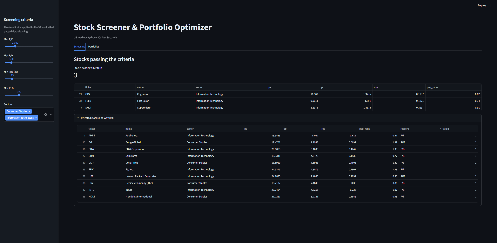
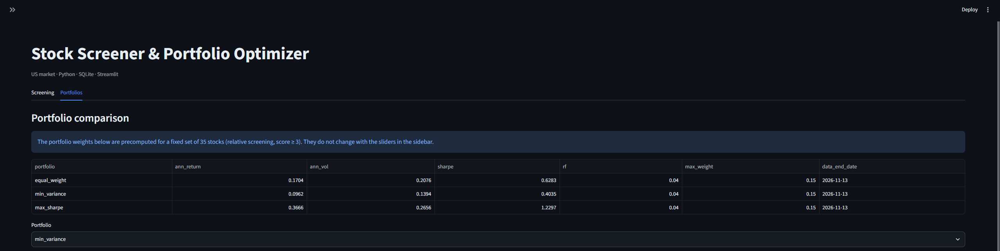
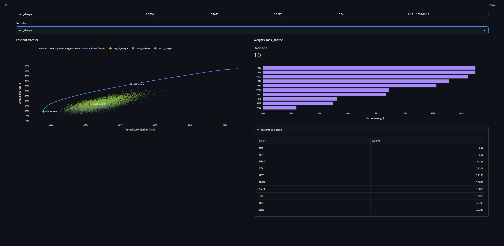

# Stock Screener & Portfolio Optimizer

A Python / SQLite / Streamlit project on US stocks (S&P 500, Information Technology
and Consumer Staples). It screens stocks on fundamentals (P/E, P/B, ROE, PEG), builds
minimum-variance and maximum-Sharpe portfolios with Markowitz optimization, and then
tests how well those portfolios hold up on data they were not fitted on.

**Question:** which US stocks look cheap on fundamentals, and how should money be
split among them for the best balance of return and risk?

## Key findings

| Step | Result |
|---|---|
| Data | Daily adjusted close prices, 2021-11-15 to 2026-11-13 (yfinance); fundamentals downloaded on 2026-11-13 |
| Universe | 109 stocks, 92 left after data-quality rules (negative equity, no positive earnings, short history) |
| Screening | Absolute thresholds: 3 stocks pass all four criteria. Relative-to-sector method (score >= 3 of 4): 35 stocks |
| In-sample Sharpe (common period with SPY, 1,249 trading days, rf = 4%) | Max Sharpe 1.23, equal-weight 0.64, min variance 0.42, SPY 0.49 (the dashboard shows 1.230 / 0.628 / 0.404 because it uses all 1,254 days of the stocks, without SPY) |
| Weight stability (two 2.5-year halves) | Weights shift by 0.40 (min variance) and 0.78 (max Sharpe), on a scale of 0 to 1 |
| Out-of-sample Sharpe (weights fitted on first half) | Max Sharpe 1.71 -> 0.26, equal-weight 0.44 -> 0.85 |

**Main takeaway:** the optimized portfolios looked far better than the benchmark
in-sample, but the advantage did not survive on the later period. The equal-weight
portfolio was the best of the three there. This is one split of one dataset, not
proof that optimization never adds value (see Limitations).

## Dashboard


*Adjustable absolute screening thresholds (defaults: P/E <= 25, P/B <= 3, ROE >= 15%, PEG <= 1.5); 3 stocks pass all four, and the table below lists the rejected stocks with the criteria they fail.*


*Annualised return, volatility and Sharpe ratio of the three portfolios (risk-free rate 4%, cap of 15% per stock).*


*Efficient frontier with 10,000 random portfolios (coloured by Sharpe ratio) and the three portfolios compared. On the right: the max Sharpe weights, 10 stocks with a 15% cap per stock.*

## How to run

Requires Python 3 (developed on 3.14) and an internet connection for the download steps.

```bash
# 1. Clone the repository and enter it
git clone https://github.com/<your-username>/stock-screener-portfolio-optimizer.git
cd stock-screener-portfolio-optimizer

# 2. Create and activate a virtual environment, then install the dependencies
python -m venv .venv
.venv\Scripts\activate          # Windows; on macOS/Linux: source .venv/bin/activate
pip install -r requirements.txt

# 3. Start the dashboard
streamlit run app.py
```

The repository includes the SQLite database (`data/portfolio.db`) with all tables
already computed, so step 3 works without downloading anything. The dashboard reads
the results from the database and does not run the optimization itself.

### Rebuilding the data from scratch (optional)

Run the scripts from the repository root, in this order. The download steps use
yfinance, which is unofficial and returns live data, so a new run will give slightly
different numbers than the ones reported above.

```bash
python src/get_tickers.py        # S&P 500 list from Wikipedia -> data/sp500_universe.csv
python src/fetch_fundamentals.py # P/E, P/B, ROE, PEG per stock -> data/fundamentals_raw.csv
python src/create_db.py          # creates the empty SQLite schema
python src/load_static.py        # loads companies and fundamentals into the database
python src/fetch_data.py         # 5 years of daily prices -> table prices
python src/clean_data.py         # data-quality rules -> table data_quality
python src/screening.py          # SQL screening -> table screen_results
python src/optimize.py           # optimal weights, efficient frontier, Monte Carlo cloud
python src/fetch_benchmark.py    # SPY prices -> table benchmark_prices
python src/compare_spy.py        # portfolios vs SPY (in-sample)
python src/sensitivity.py        # weights in two periods (stability)
python src/out_of_sample.py      # weights from period 1, evaluated on period 2
```

## Project structure

```text
app.py                  Streamlit dashboard (reads tables from the database)
requirements.txt        Python dependencies
.streamlit/config.toml  Dark theme for the dashboard
data/                   CSV files and the SQLite database (portfolio.db)
src/                    Pipeline scripts, in the order listed above
  returns.py            Exploratory step: returns, correlations, first Monte Carlo
  check_db.py, screen_check.py, inspect_missing.py
                        Small diagnostic scripts used while cleaning the data
notebooks/              Early exploration scripts
figures/, images/       Static charts from earlier steps and README screenshots
```

## Limitations

These results describe one dataset and one period. They are not a forecast and not investment advice.

- **Noisy return estimates.** Mean returns estimated from five years of data are very uncertain: for a stock with 30% annual volatility the standard error is roughly 13 percentage points (rough approximation, assuming independent daily returns). Max Sharpe optimization treats these means as true values, so it tends to favour stocks whose past average happened to be lucky. The project reduces this effect (weights >= 0, 15% cap per stock, minimum variance as the main result, equal-weight as reference) but does not remove it. The out-of-sample test shows the consequence: Sharpe fell from 1.71 to 0.26.
- **Look-ahead bias.** Today's fundamentals are applied to past prices, and the 35 stocks were selected knowing how the whole period turned out. The comparison with SPY is therefore not a real backtest, and the out-of-sample test does not remove this bias.
- **Period and sector bias.** 2021-2026 contains a strong rally in technology, and only two sectors are covered. More data would not fix this; it can only be stated.
- **One split only.** The stability and out-of-sample tests cut the data once, in the middle (the stability test uses 627 + 627 trading days; the out-of-sample test fits on 622 days and evaluates on 627). The second half behaves very differently from the first (the Sharpe ratio of SPY rose from 0.23 to 0.78), and no significance test was run. The result does not show that optimization never adds value.
- **Screening is a judgement.** The thresholds and the rule "score >= 3" are my choices. The absolute and the relative method select completely different top stocks (no stock in common), and the relative method finds stocks that are cheaper than their sector peers, not necessarily cheap. 9 stocks with negative equity (for example MO and PM) are excluded because P/B and ROE cannot be interpreted for them; this does not mean they are bad investments.
- **Simplified portfolio maths.** Returns assume constant weights every day (daily rebalancing) and no transaction costs. The risk-free rate (4%) is a judgement applied to the whole period, and annual return is computed as mean daily return x 252, which slightly overstates compound return.
- **Data source.** yfinance is unofficial, can return gaps, and returns live data, so a new download gives slightly different numbers. Fundamentals have a single download date (2026-11-13). The database is included so the dashboard does not depend on yfinance.
- **Dashboard.** The screening sliders and the portfolio weights are independent: the weights are precomputed for the fixed set of 35 stocks and do not change with the sliders. The sliders also have upper limits (for example P/E 100), so a stock like CRWD (P/E 4,535) can never pass.